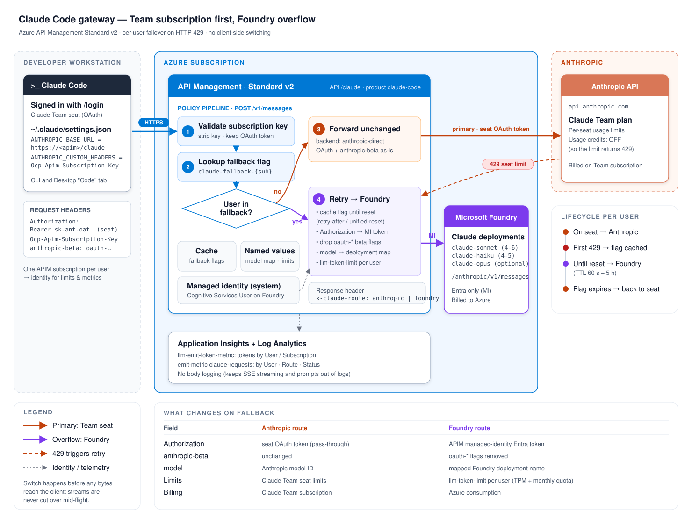
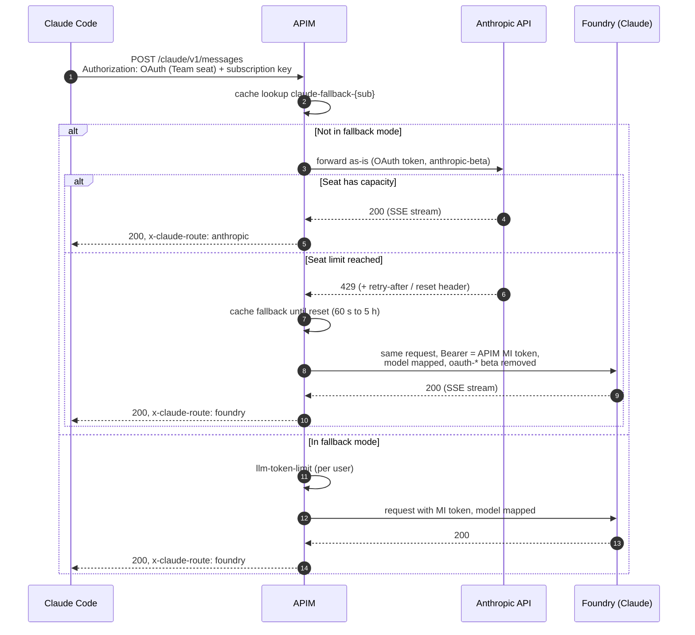

# Claude Code gateway: Team subscription first, Foundry overflow

Azure API Management (Standard v2) in front of Claude Code, so that:

1. Requests use the developer's **Claude Team seat** (subscription OAuth token, passed through untouched).
2. When the seat hits its usage limit (Anthropic returns **HTTP 429**), the same request is resent to **Claude on Microsoft Foundry**, billed to Azure.
3. The user stays on Foundry until Anthropic's limit resets, under **per-user token limits**, and then returns to the Team seat automatically.

No client-side switching. Each developer has one APIM subscription key and their normal `/login`.

---

## Architecture



<sub>Source: [`docs/architecture.svg`](docs/architecture.svg) (editable). PNG export: [`docs/architecture.png`](docs/architecture.png).</sub>

### Request flow



The switch to Foundry happens before any response bytes reach Claude Code, so a stream is never interrupted halfway.

---

## Repository layout

| Path | Purpose |
|---|---|
| `docs/architecture.svg` / `.png` | Architecture diagram |
| `policies/api-policy.xml` | API-level policy: caller identity, strip gateway key, default backend, metrics, `x-claude-route` header |
| `policies/messages-operation-policy.xml` | `POST /v1/messages`: 429 failover, fallback cache, model mapping, per-user limits |
| `infra/main.bicep` | APIM Standard v2, backends, named values, API + operations, product, App Insights, diagnostics |
| `infra/modules/foundry-role.bicep` | Grants APIM's managed identity *Cognitive Services User* on the Foundry account |
| `infra/main.bicepparam` | Parameters to edit before you deploy |
| `scripts/list-foundry-deployments.sh` | Lists the Claude deployments on your Foundry account and prints a suggested `foundryModelMap` |
| `scripts/add-user.sh` | Creates a user's APIM subscription and prints their Claude Code settings |
| `client/settings.example.json` | Claude Code `~/.claude/settings.json` example |

---

## Configuration steps

### 1. Prerequisites

- Claude **Team** plan, with members using Claude Code.
- An **existing Microsoft Foundry account** with at least one Claude deployment. This template doesn't create Foundry or deploy models.
- Azure CLI 2.60+ with Bicep.
- **Owner** (or Contributor + User Access Administrator) on the APIM resource group **and** on the Foundry account, because the template gives APIM's managed identity a role on the account.

### 2. Configure the Team plan

In **Claude → Organization settings → Usage**, turn **usage credits off** for the users who will route through this gateway (or for the whole org).
If usage credits are on, Anthropic keeps serving those users and bills the overage itself, so the 429 that triggers the Foundry fallback never comes back.

### 3. Edit parameters

Find your Foundry account and its Claude deployments:

```bash
# Foundry accounts in the subscription
az cognitiveservices account list --query "[?kind=='AIServices'].{name:name, rg:resourceGroup, location:location}" -o table

# Claude deployments on the account, plus a suggested model map
./scripts/list-foundry-deployments.sh <foundry-rg> <foundry-account>
```

In `infra/main.bicepparam`, set:

- `apimName`, `publisherEmail`, `publisherName`
- `foundryAccountName`, `foundryResourceGroup`: your existing account
- `foundryModelMap`: `prefix=deployment;...;*=default`. Claude Code sends Anthropic model IDs (for example `claude-sonnet-…`), and the **first matching prefix** decides which Foundry deployment gets the request, so list more specific prefixes first. `*` catches any model ID that doesn't match, for example Opus when you have no Opus deployment.
- Per-user Foundry limits: `foundryTpmPerUser`, `foundryMonthlyTokenQuotaPerUser`

The deployment fails at the start if the account or resource group doesn't exist. Deployment names in the map aren't checked, so a typo shows up later as a 404 on the fallback route.

### 4. Deploy

```bash
az group create -n rg-claude-gw -l swedencentral
az deployment group create \
  -g rg-claude-gw \
  -f infra/main.bicep \
  -p infra/main.bicepparam
```

Provisioning Standard v2 typically takes a few minutes. The output `gatewayUrl` is the `ANTHROPIC_BASE_URL` value for clients.

What the deployment creates:

| Resource | Setting |
|---|---|
| APIM Standard v2 | System-assigned managed identity |
| Backend `anthropic-direct` | `https://api.anthropic.com` |
| Backend `foundry-claude` | `https://<foundry>.services.ai.azure.com/anthropic` |
| API `claude` (path `/claude`) | Operations: `POST /v1/messages` (failover), `POST /v1/messages/count_tokens`, `GET /*`, `POST /*` (passthrough) |
| Product `claude-code` | Subscription required, no approval |
| Named values | Model map, token audience, fallback TTL, per-user limits |
| App Insights + logger | Metrics on, **no body logging** (keeps SSE streaming intact and prompts out of logs) |
| Role assignment | *Cognitive Services User* for the APIM identity on your existing Foundry account |

Not created: the Foundry account, project and Claude deployments. They must already exist.

### 5. Onboard users

```bash
./scripts/add-user.sh rg-claude-gw <apim-name> dana@contoso.com
```

This creates subscription `cc-dana-contoso-com` on the `claude-code` product and prints the user's settings. The subscription's display name is the user's email, which is what appears in the metrics.

### 6. Configure Claude Code (each developer)

`~/.claude/settings.json` (or deploy as managed settings):

```json
{
  "env": {
    "ANTHROPIC_BASE_URL": "https://<apim-name>.azure-api.net/claude",
    "ANTHROPIC_CUSTOM_HEADERS": "Ocp-Apim-Subscription-Key: <per-user-key>"
  }
}
```

Then run `claude`, followed by `/login` with the Team account.

> **Do not** set `ANTHROPIC_API_KEY`, `ANTHROPIC_AUTH_TOKEN`, or `apiKeyHelper`. Claude Code sends any of those in place of the subscription OAuth token, so requests would stop using the Team seat.

### 7. Verify

1. **Anthropic route**: make a normal request. The response header `x-claude-route` should be `anthropic`, and the usage should count against the user's seat (check under Settings → Usage).
2. **Foundry route (forced)**: send one request with the header `x-claude-force-route: foundry`:
   ```bash
   curl -sS -D - "https://<apim>.azure-api.net/claude/v1/messages" \
     -H "Ocp-Apim-Subscription-Key: <key>" \
     -H "x-claude-force-route: foundry" \
     -H "anthropic-version: 2023-06-01" -H "content-type: application/json" \
     -d '{"model":"claude-sonnet-4-6","max_tokens":64,"messages":[{"role":"user","content":"ping"}]}'
   ```
   Expect `x-claude-route: foundry` and `x-foundry-remaining-tokens` headers. The header doesn't create a cache entry, so the next request goes back to Anthropic.
3. **Foundry route from Claude Code**: force the route in the client (see [Forcing the Foundry route](#forcing-the-foundry-route)) and do a real task: edit a file, use a tool, get a long streamed answer. This checks that Foundry accepts the `anthropic-beta` flags Claude Code sends. If it returns 400 errors that mention `anthropic-beta`, add those flags to the `betaForFoundry` filter in `policies/messages-operation-policy.xml`.
4. **Real failover**: when a seat hits its limit, the first 429 should switch that user to Foundry. Use APIM **Test → Trace** to check the `retry` iteration and the `cache-store-value` duration.
5. **Monitoring**: in App Insights → Metrics, under the custom namespace `claude-gateway`, `claude-requests` can be split by `Route` and `User`. Token counts by user come from `llm-emit-token-metric`.

### Forcing the Foundry route

The request header `x-claude-force-route: foundry` sends that request straight to Foundry, skipping Anthropic. It doesn't write a fallback cache entry, so requests without the header go back to the normal route. APIM removes the header before forwarding.

In Claude Code, add it to `ANTHROPIC_CUSTOM_HEADERS`, one header per line, alongside the subscription key.

**Settings file** (`~/.claude/settings.json`; restart `claude` after editing):

```json
{
  "env": {
    "ANTHROPIC_BASE_URL": "https://<apim-name>.azure-api.net/claude",
    "ANTHROPIC_CUSTOM_HEADERS": "Ocp-Apim-Subscription-Key: <key>\nx-claude-force-route: foundry"
  }
}
```

**One shell session only** (overrides the settings file, nothing to clean up afterwards):

```bash
# macOS / Linux
export ANTHROPIC_CUSTOM_HEADERS=$'Ocp-Apim-Subscription-Key: <key>\nx-claude-force-route: foundry'
claude
```

```powershell
# Windows PowerShell
$env:ANTHROPIC_CUSTOM_HEADERS = "Ocp-Apim-Subscription-Key: <key>`nx-claude-force-route: foundry"
claude
```

**To confirm it worked:** App Insights shows `Route = foundry` for your requests, and usage on your Team seat doesn't go up. To go back to the normal route, remove the `x-claude-force-route` line and keep the subscription key line.

> Any user who knows this header can send their own traffic to Foundry, where it's billed to Azure and counted against their `llm-token-limit`. If you don't want users choosing their route, remove the `x-claude-force-route` clause from the `useFoundry` variable in `policies/messages-operation-policy.xml` after testing.

---

## Design decisions

- **APIM subscription key for identity, not Entra JWT.** Claude Code's `Authorization` header holds the Team OAuth token, and `ANTHROPIC_CUSTOM_HEADERS` is static, so it can't carry an Entra token that expires every hour. A per-user subscription key is static and maps cleanly to `counter-key` for limits.
- **Fallback cached per user.** Without it, every request during an exhausted window would first make a wasted round trip to Anthropic. The cache TTL comes from `anthropic-ratelimit-unified-reset` or `retry-after` when present, otherwise from `claude-fallback-default-ttl-seconds`, and is clamped to 60 s–5 h.
- **Token limits only on the Foundry route.** Anthropic seat usage is already capped by the Team plan. Only Azure-billed traffic needs a budget.
- **Only `POST /v1/messages` fails over.** Other Anthropic endpoints Claude Code calls pass through unchanged, since they're cheap and some have no Foundry equivalent.

## Caveats and things to validate in your environment

- **429 signal.** Any 429 from Anthropic triggers fallback, including short per-minute rate limits. Those normally come with a short `retry-after`, so the user returns quickly. The reset header name `anthropic-ratelimit-unified-reset` is what the policy expects for subscription limits. Check it with an APIM trace on a real limited seat and adjust the policy if your responses differ.
- **First fallback request isn't token-limited.** `llm-token-limit` runs in inbound, before the 429 is known. Every request after the first is limited.
- **Beta headers.** Only `oauth-*` flags are removed on the Foundry route. If Foundry rejects other beta flags Claude Code sends, add them to the filter in `betaForFoundry`.
- **Cache.** `caching-type="prefer-external"` uses an external Redis cache if you configure one, otherwise APIM's built-in cache. With more than one APIM unit, the built-in cache isn't shared between units, so add an external Azure Managed Redis cache.
- **Foundry token audience.** APIM requests its managed-identity token for `https://ai.azure.com`, the scope Microsoft documents for Claude on Foundry. If the fallback route returns 401, check the role assignment first, since role assignments can take a few minutes to take effect.
- **Foundry capacity.** Fallback traffic from every user who has hit their seat limit shares the capacity (TPM) of your Foundry deployments. Size them, or set `foundryTpmPerUser`, to match the overflow you expect.
- **Scope.** This covers **Claude Code** (CLI and the Code tab in Claude Desktop). Claude Desktop **chat** on a Team login talks to Anthropic directly and doesn't go through any gateway.
- **Policy format.** Both policy files are well-formed XML with escaped expressions, deployed as `format: 'xml'`. If you paste them into the portal editor, they appear unescaped, which is expected.
